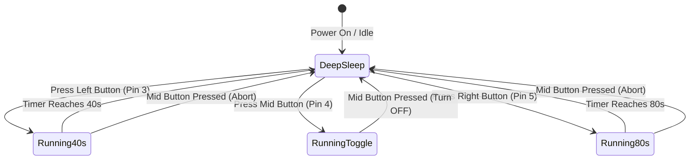

# CraftThingy ATtiny88 Water Dispenser Controller

Custom ultra-low power replacement controller for an electric rechargeable drinking water gallon dispenser pump, engineered around the **ATtiny88 (MH-ET LIVE Tiny88)** and a **logic-level N-Channel MOSFET (IRLZ44N)**.

---

## 🌟 Key Features
- **3-Button Interface**:
  - **Left Button (Pin 3)**: Automatic 40-second dispense cycle (~500ml–800ml depending on pump flow).
  - **Middle Button (Pin 4)**: Toggle Continuous ON / Immediate Cancel & Abort.
  - **Right Button (Pin 5)**: Automatic 80-second dispense cycle (~1L–1.5L).
- **Ultra-Low Power Standby (`~0.5 µA`)**:
  - Direct battery feed from 3.7V–4.2V LiPo to the ATtiny88 `5V` pin (bypassing the onboard quiescent-current LDO).
  - AVR `SLEEP_MODE_PWR_DOWN` puts the CPU to sleep when idle.
  - Wakes up instantaneously via Pin Change Interrupts (`PCINT19`, `PCINT20`, `PCINT21` on `PORTD`).
- **Heavy-Duty 12V Motor Switching**:
  - Controlled by an **IRLZ44N** logic-level N-channel MOSFET on the low side (switched ground).
  - High-side 12V rail powered via a miniature step-up boost converter (3.7V $\to$ 12V).
  - Flyback protection diode (**1N4007**) across the motor terminals to clamp inductive voltage spikes.
- **Visual Feedback**:
  - Optional LED indicator on **Pin 7** illuminates during motor activity and powers down in deep sleep.

---

## 📐 Circuit Schematic

```
===================================================================================
                       SYSTEM WIRING SCHEMATIC (TEXT-BASED)
===================================================================================

[ LIPO BATTERY / CN1 PADS (Original Board) ]
   ├── B+ (Positive, ~3.7V - 4.2V) ──────────────┬───────────────────────────────┐
   │                                             │ (Direct LiPo Power)           │ (VIN+ Boost)
   └── B- (Ground / Common Return) ──────┬───────┼───────────────┬───────────────┼───────────────┐
                                         │       │               │               │               │
                                         ▼       ▼               │               ▼               │
┌──────────────────────────────────────────────┐ │               │   ┌───────────────────────┐   │
│ ATtiny88 MICROCONTROLLER                     │ │               │   │ 12V BOOST CONVERTER   │   │
│                                              │ │               │   │                       │   │
│   [5V]  ◄────────────────────────────────────┼─┘               │   │  [VIN+] ◄─────────────┘   │
│   [GND] ◄────────────────────────────────────┘                 │   │  [VIN-] ◄─────────────────┼─┐
│                                                                │   │  [VOUT+] (12V) ──────┐    │ │
│   [Pin 3] ◄── [ Left Btn (40s Timer) ]   ────┐                 │   │  [VOUT-] ────────────┼────┼─┘
│   [Pin 4] ◄── [ Mid Btn (Toggle/Abort) ] ────┼── (To GND) ─────┘   └──────────────────────┼────┘
│   [Pin 5] ◄── [ Right Btn (80s Timer) ]  ────┘                                            │
│                                                                                           ▼
│   [Pin 6] ───[ 220Ω Resistor ]───┐                                                 [ MOTOR (+) ]
│   [Pin 7] ───[ 330Ω Resistor ]───┼──► [ LED Anode (+) ]                            [ 12V DC PUMP ]
│                                  │    [ LED Cathode (-) to GND ]                   [  & 1N4007   ]
└──────────────────────────────────┼───────────────────────────────────────────────► [ MOTOR (-) ]
                                   │                                                        │
                                   ▼                                                        │
                      ┌─────────────────────────┐                                           │
                      │ IRLZ44N MOSFET          │                                           │
                      │                         │                                           │
                      │ Gate (Pin 1) ◄──────────┘                                           │
                      │ Source (Pin 3) ─────────► (To Common Ground B-)                     │
                      │ Drain (Pin 2 / Tab) ◄───────────────────────────────────────────────┘
                      │                                 (Switched Ground Path)
                      │ * 10kΩ Pull-down Resistor placed
                      │   directly between Gate and Source
                      └─────────────────────────┘
```

### Flowchart / State Diagram



---

## 🧰 Bill of Materials (BOM)

| Component | Specification | Connection / Notes |
| :--- | :--- | :--- |
| **Microcontroller** | ATtiny88 (MH-ET LIVE Tiny88) | Runs code, low-power deep sleep via PCINT |
| **MOSFET** | IRLZ44N (N-Channel Logic-Level) | Low-side motor switch (Gate threshold < 2.5V) |
| **Boost Converter** | Mini DC-DC Step-Up (3.7V $\to$ 12V) | Stepped up from LiPo to power 12V pump motor |
| **Flyback Diode** | 1N4007 (or 1N5819 Schottky) | Soldered across motor wires (Cathode stripe $\to$ 12V+) |
| **Gate Resistor** | 220 $\Omega$ (Red-Red-Brown) | In series between ATtiny88 Pin 6 and MOSFET Gate |
| **Gate Pull-Down** | 10 k$\Omega$ (Brown-Black-Orange) | Directly across Gate and Source (prevents boot twitch) |
| **LED Resistor** | 330 $\Omega$ – 470 $\Omega$ (Optional) | In series with Status LED on Pin 7 |
| **Buffer Capacitor** | 470 $\mu$F – 1000 $\mu$F Electrolytic | Across Boost Converter `VIN+` and `VIN-` (buffers inrush) |

---

## 📌 Pinout Map

| ATtiny88 Pin | Physical Function | Active State | Notes |
| :--- | :--- | :--- | :--- |
| **Pin 3 (PB3 / PD3)** | Left Button (40s Dispense) | Active LOW | `INPUT_PULLUP` + `PCINT` |
| **Pin 4 (PB4 / PD4)** | Middle Button (Toggle / Cancel) | Active LOW | `INPUT_PULLUP` + `PCINT` |
| **Pin 5 (PB5 / PD5)** | Right Button (80s Dispense) | Active LOW | `INPUT_PULLUP` + `PCINT` |
| **Pin 6 (PC0 / PD6)** | MOSFET Gate Control | Active HIGH | Drives IRLZ44N through 220 $\Omega$ |
| **Pin 7 (PC1 / PD7)** | Status LED Indicator | Active HIGH | High during pump operation |
| **5V Pin** | Power Input | 3.2V – 4.2V | Solder to Battery `OUT+` |
| **GND Pin** | Common System Ground | 0V | Solder to Battery `OUT-` |

---

## 💡 LED Feedback & Diagnostics Table

### 1. Boot Diagnostics (Hardware Reset Codes)
| Pattern | Cause | Description / Troubleshooting |
| :--- | :--- | :--- |
| **0 Blinks** | Normal Power-On (`PORF`) | Clean start. ATtiny enters ultra-low power sleep immediately. |
| **2 Rapid Blinks + 1 Long Blink** | Brown-Out Reset (`BORF`) | Battery voltage dropped below 2.7V (inrush current or low battery). |
| **2 Rapid Blinks + 2 Long Blinks** | Watchdog Reset (`WDRF`) | CPU lockup or watchdog timeout detected. |
| **2 Rapid Blinks + 3 Long Blinks** | External Reset (`EXTRF`) | Electrical transient/noise detected on the physical Reset pin. |

### 2. Operational Mode Feedback
| Action / Mode | LED Pattern | Description |
| :--- | :--- | :--- |
| **Press 40s (Left)** | **1 Blink** $\to$ Solid ON | 40s dispense started at 100% full power. |
| **Press 80s (Right)** | **2 Blinks** $\to$ Solid ON | 80s dispense started at 100% full power. |
| **Press Middle (Toggle)** | **3 Blinks** $\to$ Solid ON | Continuous dispense started at 100% full power. |
| **Switch 40s $\to$ 80s** | **2 Blinks** $\to$ Solid ON | Dispense target extended to 80s total without stopping motor. |
| **Same-Button or Cancel** | **Instant OFF** | Pump stops immediately; board enters deep sleep. |

---

## ⚡ Flashing the Firmware

### 1. Driver Setup (Windows)
When connected via USB, the ATtiny88 identifies as **`USB\VID_16D0&PID_0753` (Micronucleus)**.
1. Download and open [Zadig](https://zadig.akeo.ie/).
2. Enable **Options** $\to$ **List All Devices**.
3. Select **Digispark** / **Micronucleus** (`16D0:0753`).
4. Set target driver to **libusb-win32** or **libusbK** and click **Install Driver**.

### 2. Uploading via Arduino IDE
1. Add URL to Board Manager: `http://digistump.com/package_digistump_index.json` or SpenceKonde `ATTinyCore`.
2. Board: **MH-ET LIVE Tiny88 (16.0Mhz)**.
3. Programmer: **Micronucleus**.
4. Click **Upload**, and wait for prompt:
   ```
   > Please plug in the device ... (will wait 60 seconds)
   ```
5. Plug the ATtiny88 into USB now (or press RESET).

